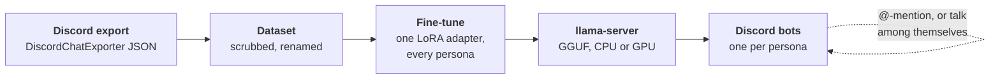

# understudy

[](https://docs.docker.com/compose/)
[](https://www.python.org/)
[](https://huggingface.co/AI-Sweden-Models/Llama-3-8B-instruct)
[](https://github.com/unslothai/unsloth)
[](https://github.com/ggml-org/llama.cpp)
[](https://github.com/Rapptz/discord.py)
[](https://github.com/microsoft/presidio)

**Your Discord friends, as bots that talk like them.**

understudy fine-tunes one small LoRA adapter on a server's chat history and runs
a Discord bot per person that answers in their voice: their slang, their
running jokes, their opinions about phones.



- **One adapter, many people.** The system prompt names the speaker:
  ``Reply as `bob`.``
- **Private by default.** Real names become pseudonyms; links, emails, phone
  numbers, addresses and stray names are scrubbed before training. Everything
  private lives in one gitignored folder.
- **One settings file.** People, profiles, bot tokens and every command's
  settings live in `private/understudy.toml`.
- **Runs in Docker.** Two images, CPU and CUDA, with every dependency pinned or
  bundled. Train on an NVIDIA GPU (WSL2 works); everything else runs anywhere.

## Before you start

- Get consent from everyone being imitated.
- Read history with a bot token only.
- Label bot output visibly, e.g. a distinct avatar and name per persona.

## Requirements

| For | Needs |
|---|---|
| everything | Docker with Compose |
| train, and serving on a GPU | an NVIDIA GPU and driver; Docker GPU support: the NVIDIA Container Toolkit on Linux, Docker Desktop's WSL2 backend on Windows |
| the bots | a Discord bot account per persona |

## Quick start

```sh
mkdir -p private && cp understudy.example.toml private/understudy.toml
# edit private/understudy.toml, export the server into private/exports/ (step 1)
docker compose --profile tools build cpu           # gpu on the training machine
docker compose run --rm cpu pipeline --to stats    # dataset, then token lengths
docker compose run --rm gpu train                  # on the GPU machine
docker compose run --rm convert                    # adapter -> GGUF
docker compose up -d serve bot                     # serve-cpu instead of serve without a GPU
```

Each job has its own image, so a machine builds only what it runs: `cpu`
(dataset, stats, bot), `gpu` (train), `convert`, and `serve` or `serve-cpu`.
Commands run as `docker compose run --rm <image> <command>`, with `private/`
mounted in place.
Downloaded models are kept in the `cache` volume.

## Settings

Everything private lives in `private/` (gitignored): the settings file, the
export, the dataset and the trained adapter. Commands run from the repo root.

`private/understudy.toml` is the only file to edit; `understudy.example.toml`
explains every setting.

```toml
[persona.bob]                          # one table per person to imitate
names = ["robert_1987", "Robban"]      # how they appear in Discord
profile = ["gaming again tonight, anyone in?"]
token = "..."                          # their bot's token

[aliases]                              # everyone else to rename
carl_xx = "carl"

[train]                                # any command's options, all optional
epochs = 3
```

- Option keys are the long options with `_` for `-`; flags on the command line
  win over the file. An unknown key stops the command.
- `understudy --config FILE <command>` reads another file.
- With `private/understudy.toml` in place, `python -m unittest discover -s tests`
  fails if a tracked file contains a name, profile line or token from it.

## 1. Export

1. Discord Developer Portal → New Application → Bot → enable **Message Content
   Intent**.
2. OAuth2 → URL Generator: scope `bot`, permissions `View Channels` and
   `Read Message History`. Invite it to the server.
3. Export:

   ```sh
   docker run --rm -v "$PWD/private/exports:/out" tyrrrz/discordchatexporter:stable \
     exportguild -t "$BOT_TOKEN" -g "$GUILD_ID" -f Json -o /out/
   ```

## 2. Build the dataset

```sh
docker compose run --rm cpu dataset      # private/exports/ -> private/data/
```

The scrubbing models download into the `cache` volume on the first run (about 1 GB).

### Renaming

Each persona's `names`, and every name in `[aliases]`, is replaced everywhere:
authors, mentions and plain text.

- Case, accents and stray marks like `´` are ignored.
- Names match whole words, plus a possessive `s`: `roberts` → `bob`. A name
  inside a longer word stays as it is; list compounds you want replaced.
- Renaming one name to two different pseudonyms is an error.
- `--persona NAME` and `--alias REAL=FAKE`, each repeatable, add more on the
  command line.

### Scrubbing

[Presidio](https://github.com/microsoft/presidio) with a Swedish spaCy model and
[GLiNER](https://github.com/urchade/GLiNER) replace, in the dataset only:

| Found | Becomes |
|---|---|
| links | `[link youtube.com]` |
| emails, phone numbers, addresses, passwords | `[email]`, `[number]`, `[address]`, `[password]` |
| towns and other places | `[place]` |
| names not renamed by the config | `[name]` |

Organisations are listed after the run, not replaced; alias the ones that
identify someone, like an employer. `--no-scrub` turns scrubbing off. The bots
don't scrub.

### Shaping

- Replies containing a link are dropped.
- `downweight` lists case-insensitive regexes. Matching replies, and matching
  context lines other than the one replied to, are kept at 20%.
- `max_per_persona` samples larger personas down. A persona needs ~500
  examples; below that, add channels or drop the persona.
- `private/data/voices.json` holds each persona's plain one-liners from the
  train split. Every example gets up to three of them, then some of its
  persona's `profile` lines, as that persona's messages a few turns from the
  end, the last profile line closest to the reply. The bots put three of them
  and the whole profile in the same place.

## 3. Train

On the GPU machine, `nvidia-smi` must work, and Docker must see the GPU: the
NVIDIA Container Toolkit on Linux, Docker Desktop's WSL2 backend on Windows.
Under WSL2, keep the repo under `~/`, not `/mnt/c/`.

```sh
docker compose --profile tools build gpu
docker compose run --rm cpu stats                     # token lengths of private/data/train.jsonl
docker compose run --rm gpu train --max-seq-length 1024   # just above p95
```

`stats` warns when p95 is above `--max-seq-length`. The adapter lands in
`private/outputs/adapter/`. `--model` picks another base model; the response
masking in `understudy train` assumes the Llama 3 chat format.

## 4. Serve

```sh
docker compose run --rm convert          # -> private/outputs/adapter.gguf
docker compose up -d serve               # on an NVIDIA GPU; serve-cpu without one
```

The model server listens on `127.0.0.1:8080` and downloads the base model into
the `cache` volume on the first run. `base_gguf` serves a local base model
instead. `lora_scale` above 1.0 exaggerates the personas; `context` sets
llama-server's context size. On a Mac, `serve-cpu` runs without the GPU, so
replies take a few times longer.

## 5. Discord bots

Each persona is its own bot account, running next to `llama-server`.

1. For each persona, in the Developer Portal: **New Application** named after
   the persona → **Bot**: set the avatar, enable **Message Content Intent**,
   copy the token.
2. OAuth2 → URL Generator for each app: scope `bot`, permissions
   `View Channels`, `Read Message History`, `Send Messages`. Open the URL and add
   the bot to the server.
3. Put each token in its persona's table: `token = "..."`.
4. Start them, with `serve` running:

   ```sh
   docker compose up -d bot
   docker compose logs -f bot
   ```

A persona replies to the channel's recent conversation when someone @-mentions
it or writes its name. `channel` limits where. In compose the bots reach the
model server as `http://llm:8080`; `llm_url` points them at another one.

### Conversations among the personas

```toml
[bot]
converse_every = 60         # minutes
converse_length = 20        # messages
converse_channel = "general"
```

One persona opens by addressing another; whoever a message names answers next,
otherwise another persona at random. A person writing in the channel ends the
conversation. Needs two or more personas with a token.

## Pipeline

```sh
docker compose run --rm cpu pipeline --to stats     # dataset -> stats
```

`pipeline` runs dataset → stats → train → convert, or a range of them with
`--from` and `--to`, and stops at the first stage that fails. Each image holds
only its own stages, so in Docker it covers dataset and stats; train and
convert run in their own images. On two machines, copy `private/data/` or
`private/outputs/` across.

## Development

```sh
docker compose --profile tools build cpu
docker compose run --rm -v .:/work --entrypoint python cpu -m unittest discover -s tests
```

Mounting the repo runs the tests on the working tree.
